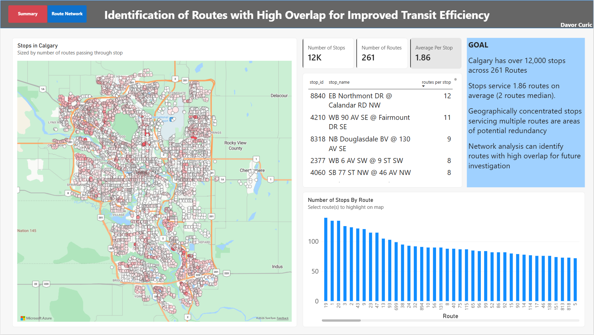
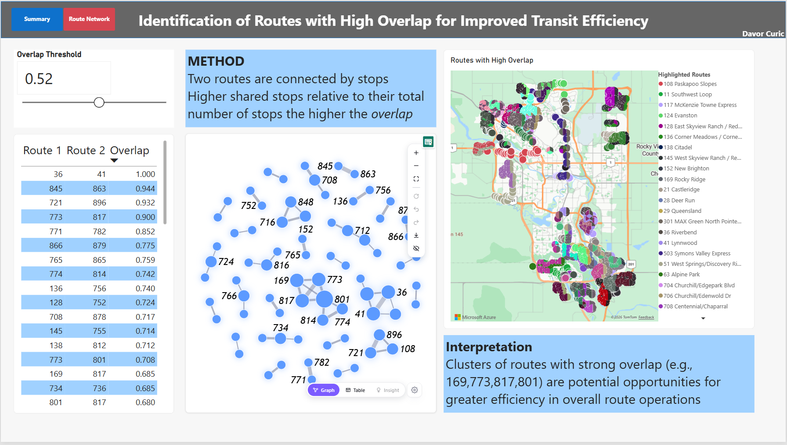

# Identifying Highly Overlapping Routes for Improved Efficiency in Open Calgary Data

An interactive Power BI dashboard that maps how Calgary Transit routes serve the city's stops and uses network analysis to find where routes overlap. Built entirely in **Power BI (Power Query + DAX)** from the City of Calgary's open GTFS data.

▶ **Video walkthrough:**

[](https://youtu.be/WcPXZgR-nPw)



## Goal

Where a stop is, and how many routes serve it, shapes how well transit works for a community. High route coverage can also be misleading. If several routes run along the same stretch, the area gets duplicated service. Those are bus and operator hours that might be better allocated elsewhere. Finding these overlaps is a first step in assessing network efficiency.

## Key findings

- **Network size:** about 12,000 stops served by 261 routes.
- **Coverage per stop:** stops are served by 1.86 routes on average (median 2). Hubs such as stop 8840 are served by 12 routes, and 11 routes each serve more than 100 stops, connecting distant parts of the city.
- **Perfect overlap is rare and can be intentional:** only one pair of routes, 36 and 41 (Riverbend/Lynnwood), shares every stop (overlap = 1.0). Route 36 runs through Riverbend first and then Lynnwood, while route 41 runs the loop in the opposite order. This overlap likely serves riders well.
- **Overlap clusters point to areas worth reviewing:** at lower thresholds, densely connected clusters appear in the network. One cluster corresponds to Rocky Ridge, where three or more routes follow each other along long stretches of stops.

These results are a starting point for a closer study and community consultation, not a recommendation to cut service. The routes may be scheduled to share a corridor deliberately.



## Methods

### Overlap measure

Each route is a node in a network. Two routes are linked if they share stops, and the link weight is the **Ochiai (cosine) similarity** of their stop sets:

```
overlap(A, B) = shared_stops(A, B) / sqrt( n_stops(A) × n_stops(B) )
```

Normalizing by the geometric mean of the two routes' stop counts means long routes don't dominate just because they have more stops. A value of 1 means the two routes serve exactly the same stops.

## Datasets

[Stops by Route](https://data.calgary.ca/Transportation-Transit/Calgary-Transit-Stops-By-Route-Cross-Reference/pm3p-838w/about_data) - route information, including each stop across each route.

[Stops](https://data.calgary.ca/Transportation-Transit/Calgary-Transit-Stops/muzh-c9qc/about_data) - stops, stop ids/ teleride number, stop location

## Power BI methods

### Generating the Network

Data: table `transit stops` from `Calgary_Transit_Stops_By_Route_Cross_Reference_20261019.csv`

**Step 1: Build the edge list (self-join)**

Duplicate `transit stops` to `SourceTargetTable`.

Reshape Data in Power Query (Self-Join) to join `transit stops` to itself using the TELERIDE_NUMBER as the matching key.

- Top Table: TELERIDE_NUMBER
- Bottom Table: TELERIDE_NUMBER
- Join Kind: Inner

From the resulting merged table, keep only the ROUTE_SHORT_NAME column. Rename remaining 'route' columns to Source and Target.

**Step 2: Clean the network (remove duplicates)**

Every route matches with itself on every stop so the table has self-loops (e.g., Route 1 connects to Route 1) and duplicate bi-directional connections (Route 1 to Route 2, and Route 2 to Route 1).

A new custom column with the following:

```
if [Source] < [Target] then 1 else 0
```

identifies self-loops and duplicates. Remove all 0 value rows.

**Step 3: Get raw weights**

Routes sharing N stops now appear in the table N times as duplicates. Group by Source and Target (count rows) into a new column `Num Shared Stops`.

**Step 4: Normalize raw counts**

In the original `transit stops` table Group by count ROUTE_SHORT_NAME to get the number of stops per route.

Join twice to SourceTargetTable, once on the source, once on the target. Name them Num_Source_Stops and Num_Target_Stops.

Create a new column named Norm with the following:

```
1 / Number.Sqrt([Num_Source_Stops]*[ Num_Target_Stops])
```

Create a new column named Overlap with the following:

```
[Num Shared Stops]*[Norm]
```

### DAX Measures

Edge filter for the table and network. The Edge Passes measure checks each edge against an Overlap Threshold parameter. It’s applied to both visuals as a visual-level filter set to **is 1**.

DAX code for measure:

```dax
Edge Passes =
-- Returns 1 if this edge's overlap exceeds the threshold slider, else 0.
-- Used as a visual-level filter (is 1) on the edge table and network visuals.
IF ( MAX ( SourceTarget_List[Overlap] ) > [Overlap Threshold Value], 1, 0 )
```

Route filter for the map visual must account for the overlap threshold and the user's selection of routes in table or network.

DAX code for measure:

```dax
Route In Overlap Network =
-- Returns 1 if the current map route appears in at least one edge
-- (as Bus 1 or Bus 2) whose overlap exceeds the threshold, else 0.
-- Respects row selections in the edge table, so clicking a pair
-- restricts the map to those routes.

-- Threshold from the slider parameter
VAR _thr = [Overlap Threshold Value]

-- Route shown in the map legend, e.g. "83 Foothills Industrial"
VAR _routeName = SELECTEDVALUE ( routes[ROUTE_NUM_NAME] )

-- Extract the leading route number ("83"); -1 if it isn't numeric
VAR _routeNum =
    IFERROR (
        VALUE ( LEFT ( _routeName, SEARCH ( " ", _routeName & " " ) - 1 ) ),
        -1
    )

-- Edge list, keeping selections made in the table but dropping
-- filters coming from the map's own route/stop context
VAR _edges =
    CALCULATETABLE (
        SourceTarget_List,
        REMOVEFILTERS ( routes ),
        REMOVEFILTERS ( stops )
    )

-- Count qualifying edges that involve this route on either side
VAR _hits =
    COUNTROWS (
        FILTER (
            _edges,
            SourceTarget_List[Overlap] > _thr
                && ( SourceTarget_List[Source] = _routeNum
                  || SourceTarget_List[Source] = _routeNum )
        )
    )

RETURN
    IF ( _hits > 0, 1, 0 )
```

## Limitations and next steps

- **Frequency isn't considered.** Overlapping routes may run less often so the neighbourhood gets consistent headways. The next step is to compare trips per hour on overlapping routes, using `stop_times.txt`.
- **Stop sharing doesn't account for direction or time of day.** Two routes can share stops while serving different trips.
- **Ridership data is not included,** so the analysis can't say which overlaps matter most to riders.

## Tools

Power BI Desktop (Power Query, DAX)

## Data licence

Contains information licensed under the Open Government Licence – City of Calgary.
